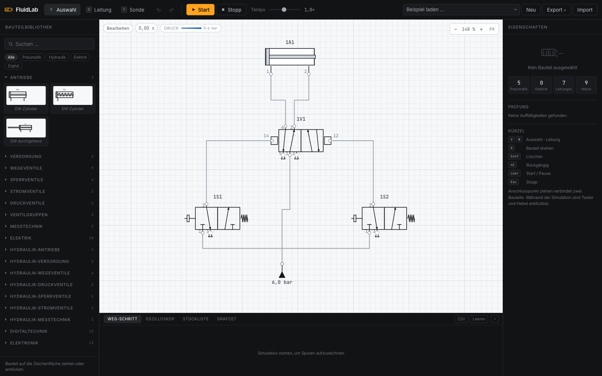
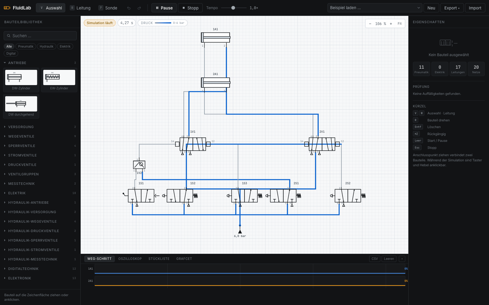

# FluidLab

**A pneumatics, electropneumatics, hydraulics and electronics simulator in the browser — built
on a real network solver instead of scripted animation.**

[](https://github.com/alex-hahn/fluidlab/actions/workflows/ci.yml)
[](docs/TESTING.md)
[](package.json)
[](LICENSE)

*Read this in [Deutsch](README.de.md) or see the [Português brasileiro guide](README.pt-BR.md).*



In the tradition of Festo FluidSIM, but the physics is solved rather than played back. Every
pressure on screen comes out of a backward-Euler gas-state integration over a union-find
network graph; every current comes out of modified nodal analysis with Newton–Raphson on the
nonlinear junctions. 14,500 lines of ES modules. No build step, no dependencies, no framework.

---

## Quick start

```bash
git clone https://github.com/alex-hahn/fluidlab.git
cd fluidlab

npm start          # → http://127.0.0.1:8777   (Node.js server, sends no-store)
npm test           # → correctness gate, 92 tests in 4 suites
```

`npm start` is a convenience wrapper — there is nothing to install. Any static server works
(`python3 serve.py 8777`), and `npm test` is `node tests/run.js`. Node ≥ 18.

> This checkout has a Brazilian Portuguese UI, component catalog and worked examples.
> The original technical documentation remains in English and German; a Portuguese
> getting-started guide is available in [README.pt-BR.md](README.pt-BR.md).

---

## Why this is not a toy

The interesting part is not the component count — it is that the behaviour is *emergent*.
None of the following is coded as a special case. Each row is a measurement the
[correctness gate](docs/TESTING.md) takes from the assembled system:

| Observation | Measurement |
| --- | --- |
| A throttle regulates speed | 0.25 s → 0.29 → 0.47 → 1.00 → 2.71 s across the adjustment range |
| End-position cushioning | impact 0.913 → 0.060 m/s at 16.5 bar chamber pressure, for 2.2 % cycle time |
| …closed too far, it becomes a spring | best at 12 % needle; 2 % and 100 % are both worse |
| Quick-exhaust valve | 62 % shorter retract time (0.125 s → 0.047 s) |
| Meter-out holds an overrunning load | 9.8 bar back pressure, controlled at 0.30 m/s |
| Meter-in loses it | 0.2 bar, 1.28 m/s — a 4.2× loss of control |
| An impulse valve stores its state | holds position 3 s with no signal at all |
| RC charging curve vs. the analytic solution | largest relative error 0.45 % over 5 τ |
| 100 kHz square wave, sub-tick sampled | 100.000 kHz measured back, 40 samples per period |
| MOSFET, √I_D extrapolation | reads back U_th = 1.94 V (declared 2.0) |
| Newton, diode from a cold start | 7 iterations; 1 thereafter |

Meter-in versus meter-out is the one that matters. No lookup table produces a 4.2× control
difference between two throttles that differ only in which port they sit on — that number
falls out of the ISO 6358 flow law meeting a force balance with stiction, or it does not fall
out at all.



---

## The numerical decisions

Three choices carry the whole design, and each is defensible on its own terms:

**Backward Euler on the gas state, damped fixed point for the nonlinearity.** A small chamber
behind a large orifice is stiff; an explicit step would be governed by the stiffest node in
the circuit rather than by the physics anyone wants to watch. Each restriction is linearised
to a secant conductance once per iteration. Iteration count and residual are published on the
snapshot, and **non-convergence is reported, never swallowed**.

**Newton–Raphson on the fluid side would be wasted; on a pn junction it is mandatory.**
`exp()` has an analytic derivative and no amount of relaxation tames a curve that steep, so
the electronics branch runs Newton with SPICE's `pnjlim` step limiting — which shortens a
step but never redirects it, and therefore converges on the true solution rather than a damped
one.

**The electrical timestep is decoupled from the 1 ms fluid tick.** A 100 kHz period is 10 µs;
sampled on the tick boundary it becomes a DC level. Components declare the step they need via
`electricDt` and the tick is divided into a whole number of them — 4000 steps of 250 ns at
100 kHz. The gate asserts both sides of this: 100.000 kHz recovered when decoupled, a
constant −10 V when not.

The same discipline applies to the model constants. The bulk modulus is **β = 1.2e8, not the
textbook 1.6e9** — the honest number for a circuit with hose and ~1 % entrained air. With the
pure-oil value a node was so stiff that a pump built 13 bar per millisecond, three times a
relief valve's entire overlap per tick, and no pressure relief valve could regulate against
it.

→ [**PHYSICS.md**](docs/PHYSICS.md) — flow law, network formulation, mechanics, hydraulics, MNA

---

## Architecture in one idea

**A controller is not a circuit.** A ladder diagram, a GRAFCET chart and a PLC program are
three notations for a specification *above* the circuit. They read its sensors and command its
actuators through one narrow channel — `sim.signal(tag)` in, `sim.energized` out — and nothing
below them knows which one is talking.

That is why adding the soft PLC cost **no change to `engine.js`**, and why a solenoid valve
cannot tell whether a ladder, a chart, a soft PLC or a real PLC on the far end of a socket is
driving it.

Two corollaries the codebase leans on hard:

- **Probes are deliberately not components.** No stamp, no port, no place in the network graph
  — the only way to *guarantee* that measurement does not perturb the circuit rather than
  merely intending it. The gate proves it over 3000 ticks with 8 probes attached: identical to
  the last bit.
- **A new component is one catalog entry.** Symbol, ports, physics, faults. No engine change,
  no inspector change. Faults are declared per component and the inspector renders whatever is
  offered, so a new defect type needs no UI work.

→ [**ARCHITECTURE.md**](docs/ARCHITECTURE.md) — module map, component contract, solver branches, controller layering

---

## What is in the box

| | |
| --- | --- |
| **Domains** | Pneumatics · electropneumatics · hydraulics · digital logic · continuous electronics |
| **Components** | 80, each with declared faults (`stuck`, `clogged`, `leak`, `coil_open`, `contact_welded`, `drift` …) |
| **Standards** | ISO 6358 flow · ISO 1219 symbols · EN 60848 GRAFCET · IEC 61131-3 ST subset |
| **Instrumentation** | 4-channel oscilloscope, edge trigger, cursors, freeze, CSV · displacement-step diagram · virtual probes |
| **Control** | Ladder · GRAFCET (R1–R5, recursive-descent condition parser, graphical chart editor) · soft PLC (ST + ladder, TON/TOF/CTU/CTD) · named I/O ports |
| **Output** | Schematic as JSON · drawing as SVG/PNG/PDF · bill of materials as CSV |
| **Tests** | 92 in 4 suites, behavioural, framework-free |

→ [**COMPONENTS.md**](docs/COMPONENTS.md) — the full library and the worked examples

---

## Controls

| | |
| --- | --- |
| `V` / `W` / `P` | select / wire / probe |
| `R` | rotate · `Del` delete |
| `Cmd/Ctrl+Z` | undo · `+Shift` redo |
| `Space` | start / pause · `Esc` stop |
| Drag from a port | connects two components |
| Scroll / `Ctrl`+scroll | pan / zoom |
| Handles between panels | resize · double-click resets |
| 4/3 hand lever | click and hold the left or right half of the symbol |

Pushbuttons and hand levers are clickable while the simulation runs. Line colour is solved
pressure (grey → blue); red is live electrical.

---

## Project layout

```
src/          9,844 lines — engine, catalogs, controllers, UI
tests/        3,423 lines — the correctness gate
docs/                      physics, architecture, testing, limitations, components
index.html                 entry point, no bundler
serve.py                   static server that sends no-store, so module edits take effect
```

---

## Limitations

The simulator states its own modelling boundaries, because one that does not invites trust it
cannot support. Hose volume is underestimated, there is no thermal dynamics, the op-amp has no
frequency response, and the WebSocket I/O driver is explicitly a stub. Hydraulics is 11 components against a full library's ~150.

→ [**LIMITATIONS.md**](docs/LIMITATIONS.md) — the complete, honest list

---

## Contributing

Five rules keep this codebase comprehensible: no dependencies, physics that emerges rather
than being scripted, a new component as one catalog entry, tests that assert behaviour, and
limitations stated honestly. They are explained in [CONTRIBUTING.md](CONTRIBUTING.md), and CI
enforces the first one.

`main` is protected — it requires a green gate and refuses force pushes.

## License

**[PolyForm Noncommercial 1.0.0](LICENSE) — noncommercial use only.**

You may read, run, study, modify and share this software freely for any noncommercial
purpose: personal study, research, experiment, hobby projects, and use by schools,
universities, public research bodies, charities and government institutions.

**Selling it, or using it in a commercial product or service, requires a separate written
licence from me.** That includes bundling it into a paid offering, using it for paid training
or consulting, and redistributing it commercially. If you want to do any of that, write to
alexanderhahn.br@gmail.com — I am open to it, I just want to agree the terms first.
